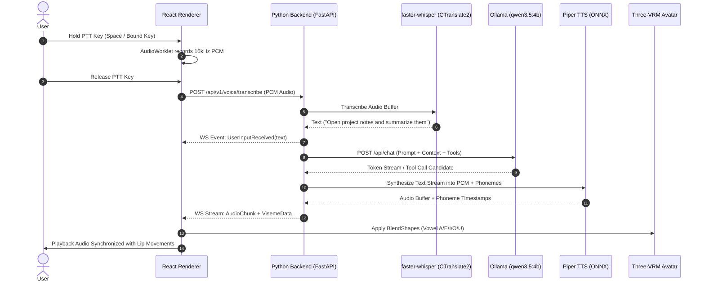
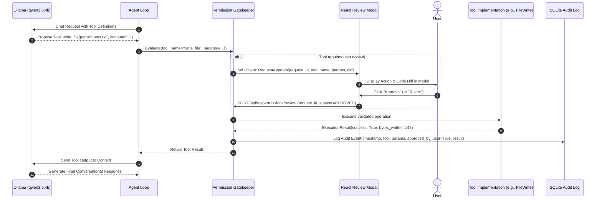

# AURA System Architecture

## 1. Executive Summary & Vision

**AURA (Autonomous Utility, Reasoning and Automation)** is an offline-first, private Windows desktop companion. It pairs a Three.js/VRM animated avatar with an autonomous reasoning engine driven by local language models, on-device speech processing, and a permission-controlled automation layer.

### Core Architecture Axioms
1. **Zero External Inference Dependency**: All conversational and reasoning intelligence runs on local hardware using Ollama (`qwen3.5:4b` baseline).
2. **Strict Physical Isolation of Data**: No voice samples, prompt histories, local files, or telemetry are ever broadcast to commercial cloud APIs.
3. **Localhost Process Decoupling**: An Electron/React frontend operates as a secure visual/auditory shell, communicating exclusively over localhost with an isolated Python backend process.
4. **Deterministic Security Boundary**: The AI cannot independently run arbitrary shell scripts or touch arbitrary disk paths. Every tool is strongly typed via Pydantic and evaluated by an explicit permission gatekeeper.
5. **Auditable Outcome Verification**: Every automated side effect (filesystem change, app launch, browser automation) generates a structured audit log and verifiable return state.

---

## 2. High-Level Process Architecture

AURA is structured as a two-process desktop application with an external local inference daemon:

```mermaid
flowchart TB
    subgraph HostSystem [Windows 10/11 Host]
        OllamaDaemon[Ollama Service<br/>http://127.0.0.1:11434<br/>Model: qwen3.5:4b]
        AudioHardware[Microphone / Speaker Devices]
        TargetApps[Allowlisted Windows Executables]
        FileSystem[Scoped Local Workspaces]
    end

    subgraph DesktopClient [Electron Desktop Shell]
        subgraph MainProc [Electron Main Process (Node.js)]
            Supervisor[Backend Process Supervisor]
            IPCHandler[Validated IPC Bridge]
            WindowMgr[Window & Lifecycle Manager]
        end

        subgraph RendererProc [Electron Renderer Process (Sandboxed)]
            UI[React 18 + Vite UI]
            VRMEngine[Three.js + @pixiv/three-vrm Avatar]
            AudioCapture[Push-to-Talk Web Audio / Worklet]
        end

        MainProc <-->|ContextBridge / Secure IPC| RendererProc
    end

    subgraph CoreBackend [Python Local Backend Service]
        FastAPIApp[FastAPI Async Gateway<br/>127.0.0.1:DYNAMIC_PORT]
        AuthMiddleware[Shared Ephemeral Token Guard]
        
        subgraph ReasoningEngine [Reasoning & Agent Subsystem]
            AgentLoop[ReAct / Tool-Calling Loop]
            OllamaClient[Async Ollama Client]
            MemoryManager[Memory & Context Assembler]
        end

        subgraph VoiceSubsystem [Local Voice Pipeline]
            STTEngine[faster-whisper Engine<br/>CTranslate2]
            TTSEngine[Piper TTS Engine<br/>ONNX Runtime]
            PhonemeAligner[Viseme/Lip-Sync Generator]
        end

        subgraph AutomationSubsystem [Scoped Automation Engine]
            ToolRegistry[Typed Tool Registry]
            PermissionGate[Permission & Review Gatekeeper]
            FileService[Scoped File Manager]
            AppLauncher[Allowlisted Process Launcher]
            BrowserWorker[Playwright Headless/Headed Worker]
        end

        subgraph StorageLayer [Local Persistence]
            SQLiteDB[(SQLite WAL Database)]
            VecStore[(Vector / Semantic Index)]
        end
    end

    Supervisor -->|Spawns with token via Stdin/Arg| FastAPIApp
    RendererProc <-->|HTTP / WS with Bearer Token| FastAPIApp
    OllamaClient <-->|REST API| OllamaDaemon
    AudioCapture -->|PCM Audio Streams| FastAPIApp
    FastAPIApp -->|WAV/PCM Audio + Visemes| RendererProc
    STTEngine <--> AudioHardware
    TTSEngine <--> AudioHardware
    FileService <--> FileSystem
    AppLauncher <--> TargetApps
    BrowserWorker <-->|Chromium Automation| HostSystem
    FastAPIApp <--> SQLiteDB
```

---

## 3. Component Responsibilities

### 3.1 Electron Desktop Shell (Presentation & OS Interface)
* **Electron Main Process**:
  * Lifecycle management: Detects and launches the Python backend sidecar.
  * Shared Secret Generation: Creates a cryptographically random, ephemeral authentication token on startup and injects it into the Python child process.
  * Health monitoring: Pings backend `/health` endpoint and handles automatic graceful restarts or graceful teardown.
  * Native OS shell integration: System tray, native notifications, window state restoration.
* **Electron Preload Layer**:
  * Exposes an immutable, type-safe API via `contextBridge.exposeInMainWorld('auraAPI', ...)`.
  * Enforces zero exposure of `child_process`, `fs`, or Node core modules to the UI.
* **React 18 Renderer Process**:
  * Sandboxed WebGL Canvas hosting Three.js and `@pixiv/three-vrm`.
  * Conversational UI: Chat message lists, tool status indicators, reasoning diffs, human-in-the-loop review dialogues.
  * Push-to-Talk (PTT) audio capture utilizing standard Web Audio APIs (`AudioWorkletNode`).
  * Viseme player syncing phoneme timing events from Piper TTS with VRM blendshapes (`mouthOpen`, `mouthSmile`, vowel shapes `aa`, `ih`, `ou`, `ee`, `oh`).

### 3.2 Python Local Backend (FastAPI Core)
* **Network & Security Layer**:
  * Binds strictly to `127.0.0.1` on a dynamically assigned or configured local port.
  * Validates every incoming HTTP request and WebSocket connection using the shared startup token.
* **Agent Orchestration**:
  * Executes a deterministic ReAct/Tool-calling loop.
  * Inspects tool calls proposed by `qwen3.5:4b`.
  * Enforces iteration thresholds (e.g., maximum 10 reasoning cycles per user request) to prevent infinite loops.
* **Local Voice Subsystem**:
  * **STT**: `faster-whisper` running locally via CTranslate2. Processes buffered WAV/PCM chunks upon PTT release.
  * **TTS**: `Piper TTS` executing through ONNX Runtime. Generates 22.05kHz mono audio alongside a JSON metadata stream containing phoneme boundaries for lip-sync.
* **Storage & Memory Layer**:
  * SQLite configured in WAL (Write-Ahead Logging) mode.
  * Stores conversations, messages, execution audits, user approvals, and episodic facts.
  * Uses local embedding models (e.g., `all-MiniLM-L6-v2` via ONNX or Ollama embedding endpoints) for semantic recall.

### 3.3 Automation & Computer Control Layer
* **Typed Tool Registry**:
  * Every tool is a validated Pydantic model exporting strict JSON Schema definitions into Ollama's tool-calling interface.
* **Security & Approval Gatekeeper**:
  * Categorizes tool calls into:
    1. *Safe / Auto-Proceed* (e.g., read local approved project documentation).
    2. *Request Review* (e.g., writing a file, creating a directory, launching a browser).
    3. *Blocked / Denied* (e.g., accessing Windows system directories, executing unlisted binaries).
* **Execution Engines**:
  * **File Engine**: Strictly canonicalized path verification (`pathlib.Path.resolve()`), confined to designated workspace roots.
  * **App Launcher**: Launches approved desktop executables with validated arguments via explicit non-shell `subprocess.Popen` arrays.
  * **Browser Worker**: Playwright-managed Chromium instance for directed web retrieval, scoped navigation, and page inspection.

---

## 4. Data Flow Specifications

### 4.1 Voice Interaction Pipeline (Push-to-Talk)



### 4.2 Tool Execution & Review Gate Pipeline



---

## 5. API Boundaries & Protocols

### 5.1 Electron IPC Interface (`auraAPI`)
The renderer never talks to OS primitives directly. It invokes preload wrappers:

```typescript
// IPC API exposed via contextBridge
export interface IAuraDesktopBridge {
  // System Lifecycle
  getBackendStatus: () => Promise<{ status: 'running' | 'starting' | 'stopped'; port: number }>;
  restartBackend: () => Promise<boolean>;

  // Window Controls
  minimizeWindow: () => void;
  maximizeWindow: () => void;
  closeWindow: () => void;

  // Ephemeral Connection Details
  getConnectionCredentials: () => Promise<{ port: number; token: string }>;
}
```

### 5.2 Python Local REST & WebSocket API
All endpoints enforce HTTP Bearer authentication validated against the process token.

| Endpoint | Method | Purpose | Payload / Protocol |
| :--- | :--- | :--- | :--- |
| `/health` | GET | Readiness and dependency verification | Status of Ollama, Whisper, Piper, DB |
| `/api/v1/chat/completions` | POST | Synchronous or SSE streaming chat | Input messages, active session ID |
| `/api/v1/voice/transcribe` | POST | Speech-to-text inference | `multipart/form-data` audio blob |
| `/api/v1/voice/synthesize` | POST | Text-to-speech with viseme timing | JSON prompt -> Audio stream + Phoneme JSON |
| `/api/v1/permissions/review` | POST | User resolution of approval modals | `requestId`, `approved: boolean`, `reason` |
| `/api/v1/tools/catalog` | GET | Current registered tool schemas | JSON Schema list of available capabilities |
| `/api/v1/ws` | WS | Real-time agent status, thoughts, audio | Bi-directional WebSocket stream |

---

## 6. Proposed Workspace & Directory Structure

```text
AURA/
├── .github/                      # CI workflows, linting, quality gates
├── docs/                         # Architectural documentation & ADRs
│   ├── architecture.md
│   ├── roadmap.md
│   ├── security.md
│   └── decisions/
│       └── initial-stack.md
├── apps/
│   └── desktop/                  # Electron + React + Three.js Client
│       ├── package.json
│       ├── tsconfig.json
│       ├── vite.config.ts
│       ├── src/
│       │   ├── main/             # Electron Main Process
│       │   │   ├── index.ts
│       │   │   ├── supervisor.ts # Python process launcher & manager
│       │   │   └── security.ts   # CSP, IPC validation, window guards
│       │   ├── preload/          # Secure ContextBridge
│       │   │   └── index.ts
│       │   └── renderer/         # React Application
│       │       ├── src/
│       │       │   ├── components/
│       │       │   │   ├── avatar/       # Three.js & @pixiv/three-vrm canvas
│       │       │   │   ├── chat/         # Message feed, streaming display
│       │       │   │   ├── voice/        # Push-to-Talk HUD & visualizer
│       │       │   │   └── modals/       # Tool Approval & Review Modals
│       │       │   ├── hooks/            # useVoiceCapture, useAuraWebSocket
│       │       │   ├── services/         # Typed API clients for local backend
│       │       │   └── store/            # UI state management (Zustand)
│       │       └── index.html
├── services/
│   └── backend/                  # Python FastAPI Core
│       ├── pyproject.toml        # Dependencies (Poetry or PDM)
│       ├── aura_backend/
│       │   ├── __init__.py
│       │   ├── main.py           # FastAPI entrypoint & lifespan
│       │   ├── config.py         # Pydantic Settings & environment validation
│       │   ├── api/              # Route controllers (REST & WebSockets)
│       │   ├── core/             # Process management & token auth
│       │   ├── agent/            # Orchestration & ReAct loop
│       │   │   ├── loop.py
│       │   │   ├── prompts.py
│       │   │   └── context.py
│       │   ├── ai/               # Ollama client & model connectors
│       │   │   └── ollama_client.py
│       │   ├── voice/            # Speech processing
│       │   │   ├── stt.py        # faster-whisper integration
│       │   │   ├── tts.py        # Piper TTS integration
│       │   │   └── phonemes.py   # Viseme calculation
│       │   ├── tools/            # Typed Tool Registry & Implementations
│       │   │   ├── base.py       # Pydantic Tool base class
│       │   │   ├── registry.py   # Registration & dispatch
│       │   │   ├── file_ops.py   # Scoped safe filesystem operations
│       │   │   ├── app_ops.py    # Allowlisted app execution
│       │   │   ├── browser_ops.py# Playwright worker bridge
│       │   │   └── web_search.py # Local search scraper (DuckDuckGo Lite)
│       │   ├── security/         # Permission evaluation & path containment
│       │   │   ├── gatekeeper.py
│       │   │   └── path_jail.py
│       │   └── storage/          # SQLite persistence & vector search
│       │       ├── models.py     # SQLAlchemy models
│       │       ├── session.py
│       │       └── memory.py     # Long-term memory extractor & retriever
│       └── tests/                # Pytest unit & integration tests
├── models/                       # Local model storage (git-ignored)
│   ├── whisper/                  # faster-whisper checkpoints
│   ├── piper/                    # piper ONNX voices & config
│   └── vrm/                      # CC0 / Open-licensed VRM models
└── scripts/                      # Local setup, formatting, and linting
    ├── setup-env.ps1
    ├── run-dev.ps1
    └── build.ps1
```

---

## 7. Memory & Context Architecture

AURA enforces a dual-tier local memory architecture to operate within local model context windows (such as `qwen3.5:4b` running comfortably at 8k–32k context). See [docs/memory.md](file:///c:/Projects/AURA/docs/memory.md) for the complete specification.

1. **Short-Term Context Buffer (Working Memory)**:
   * Holds the current session's conversation history (`sessions` and `messages` tables) up to a strict token ceiling.
   * Preserves multi-turn context for follow-up inquiries.
2. **Persistent Local Memory (Long-Term Storage)**:
   * Structured SQLite `memories` table holding categorized user facts (`preference`, `project_context`, `fact`, `instruction`, `general`).
   * **Selective Relevance Retrieval**: Token and keyword overlap scoring engine (`MemoryService.search_relevant_memories`) extracts at most top 1–3 matches above threshold. The full database is never injected into prompts.
   * **Secret Rejection Policy**: Strict pattern matching rejects private keys, API keys, JWTs, and passwords with `MemorySecurityError`.
3. **Explicit Memory Consent & User Sovereignty**:
   * The agent only commits entries to permanent memory via approved tools (`save_memory`).
   * A dedicated **Memory Review Screen** in the desktop application allows the user to inspect, search, filter, edit, pin, and permanently delete or bulk-clear any stored memories at any time.

---

## 8. Verification & Auditing Standard

Every action in AURA must produce an auditable result record:
* **Trace ID**: Assigned to every user request and passed across frontend, backend, tool invocation, and LLM completions.
* **Pre-Execution Snapshot**: For file updates, the backend captures a unified diff before applying changes.
* **Post-Execution Verification**: The tool must re-verify disk state or process status (e.g., confirming file hash changed or process PID exists) before reporting success to the model.
* **Database Ledger**: Stored permanently in SQLite with fields: `id`, `timestamp`, `trace_id`, `tool_name`, `input_params`, `approval_status`, `exit_code`, `error_message`.

---

## 9. Multi-Step Task Orchestration

AURA features a robust task orchestration engine (Implementation Phase 8) that converts high-level natural language instructions into validated, ordered, multi-step plans executed with human review gates and failure safeguards. See [docs/tasks.md](file:///c:/Projects/AURA/docs/tasks.md) for the full architectural specification.

* **Pre-Execution Plan Validation**: Plans are verified against the tool registry and Pydantic argument schemas prior to execution; invalid or prohibited tools are rejected immediately.
* **Step State Tracking & Resilience**: Finite state machines track each step (`pending`, `running`, `waiting_for_confirmation`, `completed`, `failed`, `cancelled`).
* **Circuit Breakers & Duplicate Action Prevention**: Automatic retries are capped, steps with mutations (`side_effect_occurred = True`) are blocked from duplicate retries, and total tool calls are capped.
* **Interactive Observability**: Live step progression, cancellation controls, and review gates are rendered in the desktop UI Task Activity Panel.

---

## 10. Packaging & Runtime Lifecycle Architecture

AURA supports repeatable Windows release packaging and managed sidecar execution:

* **Packaging Spec (`electron-builder.yml`)**: Targets 64-bit Windows installers (`nsis`) and portable unpacked binaries (`dir`) with pinned exact Electron versions (`34.2.0`) and bundled resources.
* **Backend Process Supervision (`supervisor.ts`)**: Electron's main process probes backend health on `http://127.0.0.1:8000/health`. In standalone production packages, it supervises the local Python sidecar process and cleanly terminates process trees (`taskkill /T /F`) during `app.on('before-quit')` to avoid orphaned database locks.
* **Origin Header & CSRF Guard**: Inbound requests to the FastAPI backend are checked against `settings.allowed_cors_origins`. Requests from untrusted web origins are rejected with HTTP 403 Forbidden.

