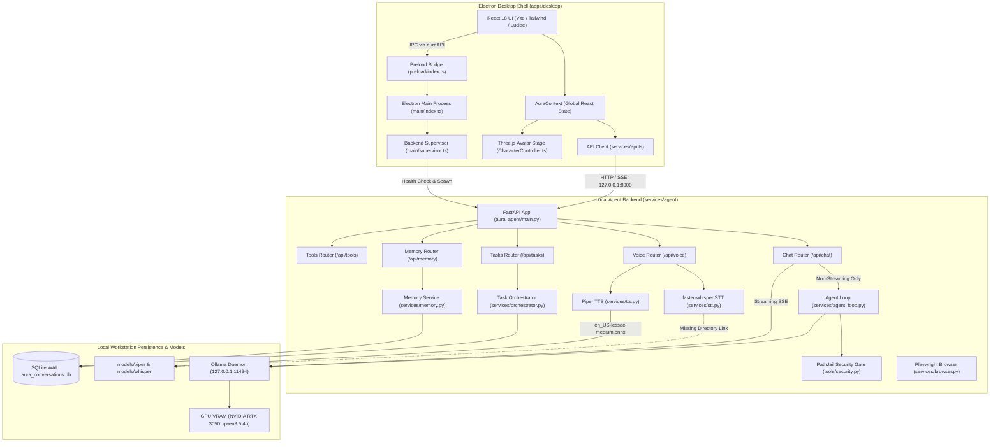
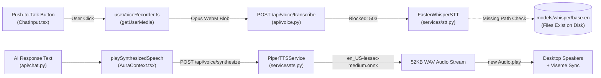
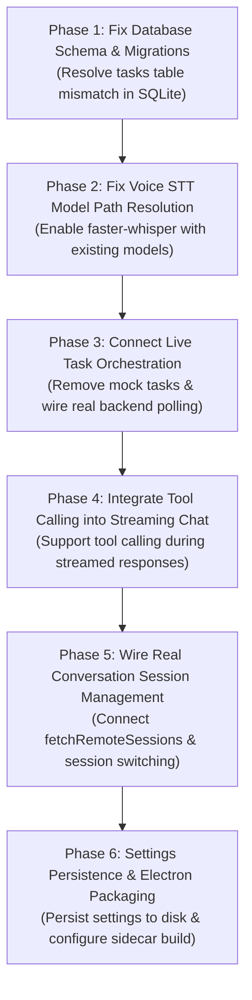

# AURA — Architectural, Security, and Codebase Audit Report
**Document ID**: `docs/audit/AURA_CURRENT_STATE.md`  
**Audit Date**: October 31, 2026  
**Auditor Role**: Principal Software Architect, Senior AI Engineer, Application Security Auditor  
**Scope**: Entire AURA (Autonomous Utility, Reasoning and Automation) Codebase across Desktop, Agent Backend, Local AI Models, On-Device Voice, 3D Avatar, and Task Orchestration.

---

## 1. Executive Summary

A comprehensive, end-to-end audit was conducted on the AURA codebase. AURA is an ambitious, local-first workstation AI assistant combining an **Electron + React + TypeScript + Three.js** desktop shell with a **Python 3.13 FastAPI** local agent backend, **Ollama** (`qwen3.5:4b`) inference, **faster-whisper** STT, and **Piper TTS**.

### Key High-Level Findings
1. **Real AI Inference Works**: Ollama is active on `127.0.0.1:11434`. The `qwen3.5:4b` model (3.14 GB) is 100% loaded into VRAM on the workstation's **NVIDIA GeForce RTX 3050 6GB Laptop GPU**. Both non-streaming and streaming SSE chat flows were tested and verified functional.
2. **Streaming Bypasses Tool Calling**: The desktop frontend always requests `stream: true`. However, the backend's streaming implementation (`api/chat.py:post_chat`) delegates directly to `OllamaClient.chat_stream()`, bypassing `AgentLoop` and all tool-calling capabilities. Tools are only callable in non-streaming mode or via explicit task execution.
3. **Critical SQLite Schema Mismatch**: The existing SQLite database on disk (`services/agent/aura_conversations.db`) has an older schema for table `tasks` (`goal`, `status`, `overall_timeout_seconds`), while the SQLAlchemy `TaskModel` expects `description`, `state`, `plan_json`. Because `create_all()` never alters existing tables, `GET /api/tasks` continuously throws `sqlite3.OperationalError: no such column: tasks.description` (HTTP 500), generating thousands of error logs every few minutes.
4. **Task Panel & "Scoped Configuration Audit" are 100% Mocked**: The task cards (`task-101` and `task-102` "Scoped Configuration Audit") in `TaskActivityPanel.tsx` are static in-memory fallback state in `AuraContext.tsx`. There is no actual `aura.config.json` on disk, no unified diff, no rollback mechanism, and the UI approval triggers a `setTimeout(..., 500)` simulation.
5. **Session History is Static Mock Data**: `ConversationHistory.tsx` renders static sessions (`sess-1`, `sess-2`, `sess-3`). The client API function `fetchRemoteSessions` is never invoked in the frontend.
6. **Voice Pipeline Gap**: Piper TTS is fully functional and produces real WAV audio. The microphone recording hook (`useVoiceRecorder.ts`) works in Chromium. However, STT transcription fails because `FasterWhisperSTT` in `services/agent/aura_agent/services/stt.py` defaults `whisper_model_dir` to `None` and lacks directory search fallbacks, failing to locate the Whisper models that are physically present in `models/whisper/`.
7. **3D Avatar Exists with Fallback**: A sophisticated Three.js + `@pixiv/three-vrm` pipeline is implemented in `CharacterController.ts`. It renders a dynamic procedural 3D holographic core by default and supports loading local `.vrm` humanoid files with state-driven expressions, head motion, and visemes. No `.vrm` model files are bundled by default.
8. **Electron Environment Trap**: If executed in an environment where `ELECTRON_RUN_AS_NODE=1` is set (common in nested IDE terminals), Electron executes as Node.js and crashes on `app.isPackaged`. Removing this environment variable allows native Electron 34 to launch cleanly. Packaged release builds (`electron-builder.yml`) currently lack `extraResources` bundling for the Python agent backend.

---

## 2. Existing Architecture



---

## 3. Existing Folder Structure

```
C:\Projects\AURA\
├── .github/
│   └── workflows/ci.yml                   # CI pipeline (lint, typecheck, tests)
├── .gitignore                             # Ignores node_modules, .venv, *.db, models, *.vrm
├── package.json                           # Workspace root package manifest
├── package-lock.json
├── README.md                              # Project documentation & setup instructions
├── apps/
│   └── desktop/
│       ├── .eslintrc.cjs                  # ESLint configuration
│       ├── electron-builder.yml           # electron-builder packaging configuration
│       ├── electron.vite.config.ts        # electron-vite configuration (main, preload, renderer)
│       ├── package.json                   # Desktop app dependencies (Electron, React, Three.js, etc.)
│       ├── tsconfig.json                  # TypeScript root config
│       ├── tsconfig.node.json
│       ├── tsconfig.web.json
│       ├── vitest.config.ts               # Vitest configuration (jsdom environment)
│       ├── src/
│       │   ├── main/                      # Electron Main Process
│       │   │   ├── index.ts               # App entrypoint, window creation, lifecycle
│       │   │   ├── ipc.ts                 # IPC channel listeners & handlers
│       │   │   ├── security.ts            # will-navigate & setWindowOpenHandler boundaries
│       │   │   └── supervisor.ts          # Python backend subprocess lifecycle monitor
│       │   ├── preload/                   # Electron Preload Bridge
│       │   │   ├── index.d.ts             # TypeScript definitions for window.auraAPI
│       │   │   └── index.ts               # contextBridge exposure of IAuraDesktopBridge
│       │   └── renderer/                  # React Frontend Application
│       │       ├── index.html             # Application HTML shell
│       │       └── src/
│       │           ├── App.tsx            # Root wrapper with AuraProvider
│       │           ├── main.tsx           # React DOM root render
│       │           ├── env.d.ts
│       │           ├── components/
│       │           │   ├── avatar/        # 3D Avatar rendering & controller
│       │           │   │   ├── AvatarStage.tsx
│       │           │   │   ├── CharacterCanvas.tsx
│       │           │   │   └── CharacterController.ts
│       │           │   ├── chat/          # Chat interface & controls
│       │           │   │   ├── ChatInput.tsx
│       │           │   │   ├── ConfirmationModal.tsx
│       │           │   │   ├── ConversationArea.tsx
│       │           │   │   └── MessageBubble.tsx
│       │           │   ├── common/
│       │           │   │   └── StateBadge.tsx
│       │           │   ├── history/       # Conversation history screen
│       │           │   │   └── ConversationHistory.tsx
│       │           │   ├── memory/        # Persistent memory inspection & review
│       │           │   │   └── MemoryReviewScreen.tsx
│       │           │   ├── settings/      # Application settings screen
│       │           │   │   └── SettingsScreen.tsx
│       │           │   ├── shell/         # Layout frame
│       │           │   │   ├── AppShell.tsx
│       │           │   │   ├── Sidebar.tsx
│       │           │   │   └── TitleBar.tsx
│       │           │   ├── status/        # System health badge
│       │           │   │   └── SystemStatusBadge.tsx
│       │           │   └── tasks/         # Task orchestration panel
│       │           │       └── TaskActivityPanel.tsx
│       │           ├── context/
│       │           │   └── AuraContext.tsx # Central React Context & global state
│       │           ├── hooks/
│       │           │   └── useVoiceRecorder.ts # MediaRecorder audio capture hook
│       │           ├── services/
│       │           │   └── api.ts         # HTTP & SSE client for FastAPI backend
│       │           ├── styles/
│       │           │   └── index.css      # Design tokens, typography, glassmorphism styles
│       │           └── types/
│       │               └── index.ts       # Shared frontend TypeScript interfaces
│       └── test/                          # Frontend Vitest test suite (27 tests)
│           ├── App.test.tsx
│           ├── AvatarStage.test.tsx
│           ├── MemoryReview.test.tsx
│           ├── setup.ts
│           ├── TaskOrchestration.test.tsx
│           ├── Tools.test.tsx
│           └── Voice.test.tsx
├── docs/                                  # Architectural specifications & guides
│   ├── architecture.md
│   ├── browser_research.md
│   ├── character_and_vrm_models.md
│   ├── development.md
│   ├── installation.md
│   ├── licenses.md
│   ├── limitations.md
│   ├── memory.md
│   ├── roadmap.md
│   ├── security.md
│   ├── tasks.md
│   ├── troubleshooting.md
│   ├── voice_licensing_and_models.md
│   └── decisions/
│       └── initial-stack.md
├── models/                                # Local model weights
│   ├── piper/
│   │   ├── en_US-lessac-medium.onnx
│   │   └── en_US-lessac-medium.onnx.json
│   └── whisper/
│       ├── base.en/
│       └── tiny.en/
└── services/
    └── agent/                             # Python 3.13 Agent Backend Service
        ├── pyproject.toml                 # pytest and tool configurations
        ├── README.md
        ├── requirements.txt               # Backend dependencies
        ├── aura_conversations.db          # Persistent SQLite database (WAL mode)
        ├── aura_agent/
        │   ├── __init__.py
        │   ├── config.py                  # Pydantic BaseSettings runtime configuration
        │   ├── main.py                    # FastAPI entrypoint & lifespan management
        │   ├── api/                       # API Routers
        │   │   ├── chat.py                # POST /api/chat, GET/DELETE /api/sessions
        │   │   ├── health.py              # GET /health
        │   │   ├── memory.py              # CRUD /api/memory
        │   │   ├── system.py              # GET /api/system/status
        │   │   ├── tasks.py               # Task planning and orchestration endpoints
        │   │   ├── tools.py               # Tool catalog, execution & confirmation
        │   │   └── voice.py               # STT & TTS endpoints
        │   ├── models/
        │   │   ├── db.py                  # SQLAlchemy declarative models & DatabaseManager
        │   │   └── schemas.py             # Pydantic request/response schemas
        │   ├── scripts/
        │   │   └── setup_voice.py         # Voice model download & verification CLI
        │   ├── services/
        │   │   ├── agent_loop.py          # Multi-turn tool execution reasoning loop
        │   │   ├── browser.py             # Playwright managed browser automation
        │   │   ├── history.py             # SQLite conversation history service
        │   │   ├── memory.py              # SQLite memory with credential rejection
        │   │   ├── ollama.py              # Async HTTP client for local Ollama
        │   │   ├── orchestrator.py        # Multi-step task planner and state machine
        │   │   ├── stt.py                 # faster-whisper CTranslate2 STT service
        │   │   └── tts.py                 # Piper TTS ONNX Runtime service
        │   └── tools/                     # Typed local tool implementations
        │       ├── audit.py               # Tool execution audit logging
        │       ├── base.py                # BaseTool, RiskTier, ExecutionContext
        │       ├── registry.py            # ToolRegistry & pending action gatekeeper
        │       ├── security.py            # PathJail & security violation handlers
        │       └── builtin/               # Builtin tools (file, note, web, app, memory)
        └── tests/                         # Backend pytest suite (88 tests)
            ├── conftest.py
            ├── test_browser_research.py
            ├── test_chat.py
            ├── test_health.py
            ├── test_history.py
            ├── test_memory.py
            ├── test_ollama.py
            ├── test_stt.py
            ├── test_system.py
            ├── test_tasks.py
            ├── test_tools.py
            ├── test_tts.py
            └── test_voice_api.py
```

---

## 4. Working Features

| Feature | Component / File | Verification Method / Evidence |
| :--- | :--- | :--- |
| **Ollama Connectivity & Inference** | `services/agent/aura_agent/services/ollama.py` | Verified against `http://127.0.0.1:11434`. Model `qwen3.5:4b` confirmed present and active. |
| **Chat Pipeline (Non-Streaming)** | `api/chat.py:post_chat` | Live tested with `Invoke-RestMethod`. Returned `"Hello there from AURA"`, evaluation metadata, and saved message to SQLite. |
| **Chat Pipeline (Streaming SSE)** | `api/chat.py:post_chat` | Live tested with `curl -N`. Verified valid `text/event-stream` chunks (`data: {"delta": ...}`) and final done event. |
| **Conversation Context Preservation** | `services/agent/aura_agent/services/history.py` | Multi-turn test verified assistant correctly recalled the second number from the preceding turn. |
| **Piper Text-to-Speech (TTS)** | `services/agent/aura_agent/services/tts.py` | Live tested via `POST /api/voice/synthesize`. Produced 52,268-byte standard PCM WAV file. |
| **Audio Playback in Frontend** | `AuraContext.tsx:playSynthesizedSpeech` | Cleans markdown syntax and instantiates `HTMLAudioElement` to play WAV blob. Updates `isSpeaking` state. |
| **3D Holographic Procedural Avatar** | `CharacterController.ts` | Renders 3D icosahedron core, outer crystalline wireframe, 3 rotating gimbal rings, and particles using Three.js WebGL. Dynamically shifts colors based on assistant state (`idle`, `thinking`, `speaking`, `executing`, `error`). |
| **VRM Humanoid Animation Engine** | `CharacterController.ts:animateVrm` | Blinks at randomized natural intervals (3-6s), breathes naturally (chest/spine sway), adjusts head tilt by state, blends vowel visemes (`aa`, `oh`) during speech. |
| **Microphone Audio Recording Hook** | `apps/desktop/src/renderer/src/hooks/useVoiceRecorder.ts` | Requests `navigator.mediaDevices.getUserMedia` with echo cancellation; captures Opus WebM audio slices. |
| **Memory Review Screen (CRUD)** | `apps/desktop/src/renderer/src/components/memory/MemoryReviewScreen.tsx` | Directly invokes `/api/memory` for list, creation, editing, category filtering, search, pinning, and deletion. |
| **PathJail & Security Boundaries** | `services/agent/aura_agent/tools/security.py` | Enforces canonical path containment, detects directory traversal (`..`), and blocks protected system roots and sensitive credential files (`.env`, `.ssh`, browser profiles). |
| **Credential Rejection in Memory** | `services/agent/aura_agent/services/memory.py` | Rejects storage of API keys (`sk-`, `ghp_`, `AKIA`), JWT tokens, private keys, or passwords. |
| **Window Frame & Custom IPC** | `TitleBar.tsx` / `main/ipc.ts` | Custom draggable title bar; minimizes, maximizes/restores, and closes the window via Electron IPC. |
| **Live System Health Polling** | `SystemStatusBadge.tsx` | Polls `GET /api/system/status` every 4s and accurately reflects backend, Ollama, STT, and TTS states. |

---

## 5. Incomplete Features

| Feature | Source Location | Incomplete Aspect / Defect |
| :--- | :--- | :--- |
| **Tool Calling in Chat** | `services/agent/aura_agent/api/chat.py` (L96-146) | When `req.stream == True`, chat streams directly from Ollama and **never invokes `AgentLoop`**. Since the desktop UI hardcodes `stream: true`, tools are never called during conversational chat. |
| **Session History Switching** | `apps/desktop/src/renderer/src/context/AuraContext.tsx` (L513-524) | `switchSession(id)` only sets `currentSessionId` in React state. It does not load messages from SQLite for that session. Messages stay static. |
| **Settings Persistence** | `apps/desktop/src/renderer/src/components/settings/SettingsScreen.tsx` | Changes made to model name, voice toggles, or volume in the settings screen only modify ephemeral React state. They are never written to `localStorage`, a configuration file, or backend storage. |
| **Packaged Release Distribution** | `apps/desktop/electron-builder.yml` | Lacks `extraResources` for packaging the Python agent backend or models. Packaged binaries (`AURA.exe`) will fail to run the backend sidecar. |
| **Ollama Tool Streaming** | `services/agent/aura_agent/services/ollama.py` (L130-181) | `chat_stream()` does not accept or pass a `tools` parameter to Ollama. |

---

## 6. Broken Features

### 6.1. SQLite `tasks` Table Schema Mismatch (Critical Bug)
- **Source Files**:
  - `services/agent/aura_agent/models/db.py` (Line 81: `TaskModel`)
  - `services/agent/aura_agent/api/tasks.py` (Line 67: `list_tasks`)
  - `services/agent/aura_conversations.db` (Physical SQLite file)
- **Manifestation**:
  The SQLite table `tasks` was originally created with columns `id`, `title`, `goal`, `session_id`, `status`, `overall_timeout_seconds`. The codebase was later updated to define `TaskModel` with columns `title`, `description`, `state`, `plan_json`. Because SQLAlchemy `Base.metadata.create_all()` never alters existing tables, `GET /api/tasks` fails with:
  ```
  sqlalchemy.exc.OperationalError: (sqlite3.OperationalError) no such column: tasks.description
  ```
  Since `AuraContext.tsx` polls `/api/tasks` every 4 seconds, this generates continuous HTTP 500 error logs and blocks real task loading.

### 6.2. Whisper STT Model Resolution
- **Source Files**:
  - `services/agent/aura_agent/config.py` (Line 32: `whisper_model_dir: Optional[str] = None`)
  - `services/agent/aura_agent/services/stt.py` (Line 93: `_resolve_model_path`)
- **Manifestation**:
  `stt.py` enforces `local_files_only=True` to prevent unexpected internet downloads. However, `_resolve_model_path()` only checks `self.model_dir` or the literal string `base.en`. Unlike `tts.py`, which includes standard search directories (`models/piper`, etc.), `stt.py` has no fallback search paths.
  Even though `C:\Projects\AURA\models\whisper\base.en` and `tiny.en` exist on disk, the backend fails to locate them, reporting:
  ```
  Whisper model 'base.en' was not found locally on disk.
  ```
  This causes `GET /api/voice/status` to report STT unavailable and `POST /api/voice/transcribe` to reject audio with HTTP 503.

### 6.3. Backend Test Harness Lifespan Overwrite
- **Source File**: `services/agent/tests/conftest.py` (Line 86: `app_instance`, Line 129: `client`)
- **Manifestation**:
  `conftest.py` initializes mock services (`MockOllamaClient`, in-memory database) on `app.state`. However, when `httpx.ASGITransport` runs, FastAPI's ASGI lifespan executes and **re-instantiates production services**, connecting to real SQLite and attempting to connect to real Ollama (`http://127.0.0.1:11434`) with a 60s timeout. This causes pytest runs in isolated environments to hang or fail.

### 6.4. Windows Environment Conflict with `ELECTRON_RUN_AS_NODE`
- **Source File**: `apps/desktop/src/main/index.ts` / `apps/desktop/package.json`
- **Manifestation**:
  When launched from environments containing `ELECTRON_RUN_AS_NODE=1`, Electron runs in Node.js CLI mode instead of Electron mode. `require('electron')` resolves to the string executable path instead of the Electron API, causing an immediate crash:
  ```
  TypeError: Cannot read properties of undefined (reading 'isPackaged')
  ```

---

## 7. Mocked Features

### 7.1. Task Cards & Scoped Configuration Audit
- **Source File**: `apps/desktop/src/renderer/src/context/AuraContext.tsx` (Lines 86–117, Lines 446–470)
- **Status**: **100% Mocked Static Data**
- **Details**:
  - `task-101` (*"Workspace Scope Verification"*) and `task-102` (*"Scoped Configuration Audit"*) are hardcoded in `initialTasks`.
  - When the backend `/api/tasks` endpoint fails with HTTP 500, `AuraContext.tsx` ignores the failure and keeps `initialTasks` displayed indefinitely.
  - Clicking "Approve" on `task-102` executes:
    ```typescript
    setTimeout(() => {
      // Fake success message claiming diff applied with SHA256 checksum
      setTasks(prev => prev.map(t => t.id === 'task-102' ? { ...t, status: 'completed' } : t));
    }, 500);
    ```
  - **Audit of `aura.config.json`**:
    - Proposed changes: **None**. The file does not exist on disk.
    - Approval endpoint: **None**. Handled purely by local UI state timeout.
    - Backup process: **Non-existent**.
    - Rollback behavior: **Non-existent**.

### 7.2. Conversation History Sessions
- **Source File**: `apps/desktop/src/renderer/src/context/AuraContext.tsx` (Lines 65–84)
- **Status**: **Hardcoded Static Data**
- **Details**:
  - `initialSessions` contains three static sessions: `"Project Architecture Review"`, `"Local Model Inference Configuration"`, and `"VRM Lip-Sync & Viseme Pipeline"`.
  - `fetchRemoteSessions()` in `services/api.ts` is implemented but is never called anywhere in the React app.
  - Deleting a session only filters the frontend array without notifying the backend.

### 7.3. Electron IPC System Status Fallback
- **Source File**: `apps/desktop/src/main/ipc.ts` (Lines 42–52)
- **Status**: **Static Placeholder Values**
- **Details**:
  - The `system:get-status` IPC handler returns static placeholder values:
    ```typescript
    return {
      ollama: 'connected',
      backend: 'ready',
      activeModel: 'qwen3.5:4b',
      memoryMb: Math.round(memoryUsage.heapUsed / 1024 / 1024),
      micReady: false
    };
    ```
  - It does not query Ollama, Python, or microphone hardware. (The React frontend primarily bypasses this by polling `/api/system/status` over HTTP, but falls back to this static handler if HTTP fails).

---

## 8. Missing Dependencies

| Dependency / Asset | Required By | Current Status | Impact |
| :--- | :--- | :--- | :--- |
| **Default VRM 3D Model** (`*.vrm`) | `CharacterController.ts` | No `.vrm` files present in `apps/desktop` or `models/`. | App gracefully falls back to the procedural 3D holographic core. Custom VRM requires manual user file selection. |
| **Whisper Model Directory Config** | `services/agent/aura_agent/config.py` | `whisper_model_dir` is `None`. Model files exist at `models/whisper/base.en`. | STT is disabled until `whisper_model_dir` is configured to point to `models/whisper`. |
| **Packaging Sidecar Spec** | `apps/desktop/electron-builder.yml` | Missing PyInstaller build configuration for standalone `aura_agent.exe`. | Standalone desktop distribution cannot be produced without manual sidecar bundling. |

---

## 9. Security Audit Findings

| Category | Component | Assessment | Severity |
| :--- | :--- | :--- | :--- |
| **Path Traversal / Jailbreak** | `tools/security.py:PathJail` | **Pass**. Strict canonicalization (`pathlib.Path.resolve()`), prohibited prefix checks (`C:\Windows`, `Program Files`, user `.ssh`, browser databases), and blocked file patterns (`.env`, `id_rsa`, credentials). | Low Risk |
| **Network Binding & Exposure** | `config.py` & `main.py` | **Pass**. Bound strictly to loopback (`127.0.0.1:8000`). No 0.0.0.0 exposure. Zero external telemetry or third-party cloud API dependencies. | Low Risk |
| **Electron Context Isolation** | `main/index.ts` | **Pass**. `contextIsolation: true`, `sandbox: true`, `nodeIntegration: false`, `webSecurity: true`, `allowRunningInsecureContent: false`. | Low Risk |
| **Electron Navigation Control** | `main/security.ts` | **Pass**. `will-navigate` blocks navigation outside `http://localhost:5173` and `file:`. External links open in default OS browser via `shell.openExternal`. | Low Risk |
| **Credential Ingestion Defense** | `services/memory.py:validate_content_safety` | **Pass**. Regex pattern scanning rejects API keys (`sk-`, `ghp_`, `AKIA`), JWTs, private keys, and passwords before insertion into SQLite. | Low Risk |
| **CORS Policy** | `config.py:allowed_cors_origins` | **Pass**. Restricted strictly to `localhost:5173`, `127.0.0.1:5173`, `localhost:3000`, `127.0.0.1:3000`. | Low Risk |
| **Untrusted Web Content Injection** | `services/browser.py` | **Pass**. Web scraping strips `<script>`, `<style>`, forms; wraps external content in `<<<UNTRUSTED_EXTERNAL_WEBPAGE>>>` delimiters with prompt injection warning banners. | Low Risk |

---

## 10. Voice Pipeline Diagnosis



### Trace Details:
1. **Microphone Capture**: `useVoiceRecorder.ts` accesses hardware via standard browser APIs upon user interaction. Releases hardware tracks immediately when stopped. Captures `audio/webm;codecs=opus`. **(Functional)**
2. **Speech-to-Text (STT)**: Frontend calls `transcribeAudio()` with WebM blob. The backend endpoint `/api/voice/transcribe` checks `stt_service.is_available()`. Because `_resolve_model_path()` cannot locate `base.en`, it throws `STTModelNotFoundError` and returns HTTP 503. **(Broken due to path resolution)**
3. **AI Generation**: Response text is generated by `qwen3.5:4b` via Ollama. **(Functional)**
4. **Text-to-Speech (TTS)**: `playSynthesizedSpeech()` strips markdown and calls `/api/voice/synthesize`. Piper TTS synthesizes the clean text using ONNX Runtime with `en_US-lessac-medium.onnx`. **(Functional)**
5. **Playback & Visemes**: The WAV audio is played through `HTMLAudioElement`. While playing, `isSpeaking` is set to `true`, which drives viseme vowel mouth blend weights in `CharacterController.ts`. **(Functional)**
6. **Health Indicators**: `SystemStatusBadge.tsx` dynamically displays live health returned by `/api/system/status`. STT correctly shows "STT Standby" (not static) because the backend explicitly reported it unavailable. TTS correctly shows "TTS Ready".

---

## 11. Avatar Implementation Status

- **Engine**: Three.js `0.186.1` with `@pixiv/three-vrm` `3.5.5`.
- **Component Stack**:
  - `AvatarStage.tsx`: UI container with telemetry HUD (FPS, render mode, model name) and file selection controls.
  - `CharacterCanvas.tsx`: React wrapper with `ResizeObserver` maintaining aspect ratio and WebGL lifecycle.
  - `CharacterController.ts`: Complete rendering and animation subsystem.
- **Rendering Modes**:
  1. **Procedural Fallback Mode (Active by default)**:
     - Central icosahedron core (`MeshStandardMaterial` with state-reactive emissive glow).
     - Outer wireframe shell.
     - Three concentric gimbal rings rotating at speeds modulated by assistant state (3.2x speed in `thinking`, 2.4x in `executing`).
     - 120 orbiting ambient particles.
     - Color palettes: Idle (Cyan), Listening (Green), Thinking (Violet), Responding/Speaking (Blue), Executing (Orange), Waiting Confirmation (Yellow), Error (Crimson).
  2. **VRM Humanoid Mode (Active when user loads `.vrm`)**:
     - Parsed via `GLTFLoader` + `VRMLoaderPlugin`.
     - T-pose arms automatically lowered to natural rest pose (`LeftUpperArm.rotation.z = -1.15`).
     - Procedural blinking loop (`VRMExpressionPresetName.Blink`) every 3–6s.
     - Procedural breathing sway (`Chest.rotation.x`, `Spine.rotation.x`).
     - Speech visemes: Modulates `VRMExpressionPresetName.Aa` and `Oh` based on audio playback state.
     - State-driven emotional expressions: `Happy` on idle, `Relaxed` on listening, `Surprised` on confirmation, `Sad` on error.
- **VRM File Assets**:
  - Zero `.vrm` model files exist in the repository.
  - To display a humanoid character, the user must provide a local `.vrm` file via the file picker.

---

## 12. Electron Implementation Status

- **Runtime**: Real native Electron `34.2.0` (not merely browser-based Vite).
- **Process Architecture**:
  - **Main Process** (`apps/desktop/src/main/index.ts`): Creates 1280x820 frameless window, registers IPC, initializes supervisor.
  - **Preload Bridge** (`apps/desktop/src/preload/index.ts`): Uses `contextBridge.exposeInMainWorld('auraAPI', ...)` to expose narrow window control and VRM loading methods.
  - **Renderer** (`apps/desktop/src/renderer/index.html`): React single-page application served by Vite in development or loaded from `out/renderer/index.html` in production.
- **IPC Channels**:
  - `window:minimize`, `window:maximize`, `window:close` — Fully functional.
  - `vrm:select-file` — Uses native Electron `dialog.showOpenDialog`.
  - `vrm:load-binary` — Reads local file buffer up to 200MB maximum.
  - `system:get-status` — Hardcoded static placeholder.
- **Installer & Packaging**:
  - `electron-builder.yml` configured for NSIS x64 Windows installer and unpacked directory.
  - Produces `apps/desktop/dist/win-unpacked/AURA.exe`.
  - **Packaging Gap**: `electron-builder.yml` lacks `extraResources` directives for packaging the Python agent backend or speech models, meaning production installations require a pre-configured Python environment.

---

## 13. Task Orchestration Diagnosis

- **Frontend Reality**:
  - The tasks rendered in `TaskActivityPanel.tsx` (`task-101` and `task-102`) originate from `initialTasks` in `AuraContext.tsx`.
  - When `fetchOrchestratedTasks()` fails with HTTP 500, `AuraContext.tsx` silently catches the error and leaves the mock tasks on screen.
- **Backend Reality**:
  - The backend contains a complete task orchestration architecture (`services/agent/aura_agent/services/orchestrator.py` and `api/tasks.py`):
    - `POST /api/tasks/plan`: Uses Ollama to decompose high-level requests into ordered, typed steps.
    - `POST /api/tasks`: Validates steps, enforces max tool call limits (circuit breaker), and stores tasks in SQLite.
    - `POST /api/tasks/{id}/execute`: State machine executing steps sequentially with retry policies and confirmation gates.
    - `POST /api/tasks/{id}/confirm`: Resumes paused tasks when human approval is granted.
    - `POST /api/tasks/{id}/cancel`: Safely halts tasks.
  - **Failure Point**: All of these endpoints fail on database queries because the SQLite table `tasks` has not been migrated to include the `description`, `state`, and `plan_json` columns required by `TaskModel`.

---

## 14. Hardware and Model Audit

| Component | Audit Observation | Specification / Status |
| :--- | :--- | :--- |
| **Dedicated GPU** | Detected via Windows CIM controller | **NVIDIA GeForce RTX 3050 6GB Laptop GPU** (Driver 32.0.16.1060) |
| **CPU** | Detected via Windows CIM processor | **13th Gen Intel(R) Core(TM) i5-13450HX** (16 Logical Processors) |
| **Integrated GPU** | Secondary video controller | Intel(R) UHD Graphics |
| **Ollama Daemon** | HTTP API on `127.0.0.1:11434` | Running locally |
| **Active Model** | Verified via `/api/ps` and `/api/tags` | **`qwen3.5:4b`** (Quantization: `Q4_K_M`, Size: 3.14 GB, Context: 4096 tokens) |
| **GPU Acceleration** | Verified via Ollama process inspection | **100% VRAM Offload Active**. Model size: 3,140,495,604 bytes; `size_vram`: 3,140,495,604 bytes. |
| **Inference Latency** | Warm turn benchmarking | ~11.5 seconds for complete round-trip inference and SQLite message persistence. |
| **Voice Model Acceleration**| Backend configuration in `config.py` | CPU only (`whisper_device="cpu"`, `piper_use_cuda=False`). |

---

## 15. Recommended Implementation Order

To transition AURA from its current partially-mocked state to a fully integrated, production-grade local assistant, the following phased plan is recommended:



### Detailed Phase Roadmap:

1. **Phase 1: SQLite Schema Synchronization & Migration**
   - Migrate `services/agent/aura_conversations.db` table `tasks` to include `description TEXT`, `state VARCHAR(30)`, `plan_json TEXT`, `max_retries_per_step INTEGER`.
   - Update `DatabaseManager.init_schema()` in `models/db.py` to check for missing columns and run lightweight `ALTER TABLE` statements automatically.
   - **Expected Outcome**: Completely eliminates the continuous HTTP 500 errors on `GET /api/tasks`.

2. **Phase 2: Fix faster-whisper Model Resolution**
   - Update `FasterWhisperSTT._resolve_model_path()` in `services/agent/aura_agent/services/stt.py` to check workspace `models/whisper/` directories as fallbacks, mirroring `PiperTTSService`.
   - Update `whisper_model_dir` in `config.py` to default to `C:\Projects\AURA\models\whisper`.
   - Fix PyAV / CTranslate2 audio decoding parameters for WebM Opus chunks.
   - **Expected Outcome**: Restores the complete voice pipeline: Microphone $\rightarrow$ `faster-whisper` STT $\rightarrow$ Qwen LLM $\rightarrow$ Piper TTS $\rightarrow$ Speaker playback.

3. **Phase 3: Connect Real Task Orchestration in UI**
   - Remove hardcoded `initialTasks` (`task-101`, `task-102`) from `AuraContext.tsx`.
   - Ensure `refreshTasks()` populates real tasks from `GET /api/tasks`.
   - Replace the fake `task-102` configuration audit simulation with genuine multi-step planning using the "New Task" planning modal (`createTaskPlan` $\rightarrow$ `createOrchestratedTask` $\rightarrow$ `executeOrchestratedTask`).

4. **Phase 4: Tool Calling Integration for Streaming Chat**
   - Refactor `api/chat.py` so that `post_chat` invokes `AgentLoop` even when `stream: true`.
   - Allow `AgentLoop` to emit SSE deltas as tokens arrive while intercepting function calls, executing tools through `PathJail`, and resuming the stream with tool results.
   - **Expected Outcome**: Users chatting via the desktop UI can trigger file searches, note creation, and web searches seamlessly.

5. **Phase 5: Real Conversation Session History**
   - Connect `fetchRemoteSessions()` in `AuraContext.tsx` on mount and after new sessions are created.
   - Update `switchSession(id)` to load message history from `GET /api/sessions/{id}/messages` and populate the chat area.
   - Update `deleteSession(id)` to call `DELETE /api/sessions/{id}` on the backend.

6. **Phase 6: Settings Persistence & Packaged Release Engineering**
   - Save application settings to `localStorage` or `aura.config.json` via a dedicated settings endpoint.
   - Configure `extraResources` in `apps/desktop/electron-builder.yml` to bundle the Python virtual environment and voice models into `win-unpacked/resources`.
   - Provide a clean npm script to launch Electron without `ELECTRON_RUN_AS_NODE`.

---

**Audit Status**: Complete. Awaiting user implementation instructions.

