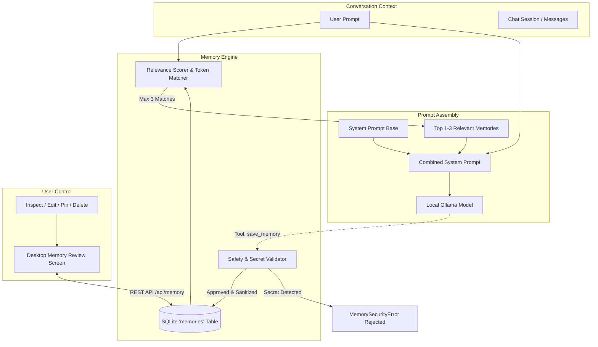

# AURA Persistent Local Memory Architecture & User Controls

## 1. Overview & Core Philosophy

AURA's **Persistent Local Memory** system (Implementation Phase 7) enables the assistant to remember user preferences, architectural rules, coding habits, and project context across distinct desktop sessions.

Unlike conventional cloud-based assistants that either serialize arbitrary chat logs to remote data centers or attempt to dump entire conversation logs into model contexts, AURA adheres to strict local-first, privacy-respecting, and resource-bounded principles:

1. **Strict Local Storage**: All memory records reside inside a local SQLite database (`%LOCALAPPDATA%\AURA\aura_conversations.db`). No external embedding APIs or paid cloud inference services are ever invoked.
2. **Context vs. Memory Decoupling**: Ephemeral conversation turns (`sessions` and `messages`) are strictly decoupled from long-term distilled knowledge (`memories`). Conversations do not automatically become permanent memories.
3. **Bounded & Scored Retrieval**: The agent never dumps the full memory database into prompts. A local token-based relevance scoring engine extracts at most 1–3 highly relevant items per prompt turn. Unrelated turns receive zero memory injection.
4. **Zero-Trust Secret Filtering**: Automatic gatekeeping rejects private keys, API keys, JWTs, and plaintext credentials before they can ever be persisted.
5. **Complete User Sovereignty**: The user can inspect, search, filter, edit, pin, and permanently delete any stored memory at any time via a dedicated **Memory Review Screen** in the desktop application.



---

## 2. Structured Storage Schema

All memories are stored in the local SQLite database managed by SQLAlchemy models located in [`services/agent/aura_agent/models/db.py`](file:///c:/Projects/AURA/services/agent/aura_agent/models/db.py#L75-L100).

### Database Table: `memories`

| Column | Type | Nullable | Description |
| :--- | :--- | :--- | :--- |
| `id` | `VARCHAR(36)` | No | Primary Key. UUIDv4 identifier. |
| `category` | `VARCHAR(64)` | No | Classification category (indexed). Allowed values: `preference`, `project_context`, `fact`, `instruction`, `general`. |
| `key` | `VARCHAR(128)` | Yes | Machine-readable or descriptive lookup key (indexed), e.g. `coding_style`, `editor_theme`. |
| `content` | `TEXT` | No | The verified factual memory text. |
| `source_session_id` | `VARCHAR(36)` | Yes | Optional UUID of the conversation session that originated the memory. |
| `confidence` | `FLOAT` | No | Confidence score between `0.0` and `1.0` (defaults to `1.0`). |
| `access_count` | `INTEGER` | No | Number of times this memory was injected into prompts or recalled. |
| `last_accessed_at` | `DATETIME` | Yes | Timestamp of most recent recall or prompt injection (UTC). |
| `created_at` | `DATETIME` | No | Creation timestamp (UTC). |
| `updated_at` | `DATETIME` | No | Last modification timestamp (UTC). |
| `expires_at` | `DATETIME` | Yes | Optional expiration timestamp for retention policies. |
| `is_pinned` | `BOOLEAN` | No | When `True`, gives priority boost during relevant searches and resists retention cleanup. |
| `metadata_json` | `TEXT` | Yes | Optional JSON string containing custom tool or user tags. |

---

## 3. Storage Location on Disk

The SQLite database file is located at:
```text
Windows: %LOCALAPPDATA%\AURA\aura_conversations.db
```
*(Default fallback in development: `./data/aura_conversations.db` or in-memory for automated unit tests).*

The SQLite connection operates under standard WAL (Write-Ahead Logging) mode, providing high concurrency between the desktop Electron frontend, background API tasks, and local database sessions.

To locate or back up your memories manually:
1. Open Windows File Explorer.
2. Navigate to `%LOCALAPPDATA%\AURA\`.
3. The file `aura_conversations.db` contains your conversation history and persistent memories.

---

## 4. Relevance-Scored Retrieval Engine

Rather than relying on resource-intensive or remote embedding vectors, AURA implements a local, deterministic, and fast token-scoring relevance engine in [`MemoryService.search_relevant_memories`](file:///c:/Projects/AURA/services/agent/aura_agent/services/memory.py#L236-L310):

1. **Tokenization & Normalization**:
   - The query and memory fields are normalized to lowercase.
   - Punctuation, dashes, and underscores are tokenized (e.g., `coding_style` yields `coding` and `style`).
   - Stop words (e.g., `the`, `is`, `and`, `to`, `what`, etc.) are filtered out.
2. **Multi-Field Weighted Scoring**:
   - **Content Match**: Each overlapping non-stopword token contributes `1.0` point.
   - **Key Match**: Overlapping key tokens receive a `2.5x` multiplier.
   - **Category Match**: Category alignment receives a `1.5x` multiplier.
   - **Exact Phrase Substring**: If the exact query string or key matches a substring in content, a `2.0` bonus is added.
3. **Topical Relevance Gate**:
   - Pinned and recency boosts are **only** applied if the base topical score is greater than zero (`base_score > 0.0`). This ensures pinned items about "TypeScript" are never injected into an unrelated question about "weather in Paris".
4. **Score Normalization & Filtering**:
   - The final score is normalized against query length.
   - Candidates below `config.memory_relevance_threshold` (default `0.1`) are pruned.
   - Top candidates are ranked and truncated to `config.memory_max_injected` (default `3`).
5. **Access Tracking**:
   - When memories are retrieved for prompt injection, their `access_count` is incremented and `last_accessed_at` is updated to UTC `now`.

### Prompt Injection Format
Selected memories are formatted as a compact markdown block injected into the LLM's system prompt:

```markdown
[RELEVANT PERSISTENT USER MEMORIES]
- [preference] coding_style: Always use TypeScript strict mode with explicit return types.
- [project_context] test_framework: Frontend tests use Vitest and React Testing Library.
Use these saved user facts when applicable. Never mention the raw memory IDs to the user.
```

---

## 5. Secret Protection & Rejection Policies

To prevent inadvertent storage of sensitive credentials, [`MemoryService.validate_content_safety`](file:///c:/Projects/AURA/services/agent/aura_agent/services/memory.py#L35-L66) inspects all content before writing to the database.

Any memory creation or update containing the following patterns is **rejected with an immediate `MemorySecurityError` (HTTP 400)**:

* **Private Keys**: `-----BEGIN (RSA|OPENSSH|DSA|EC|PGP)?\s?PRIVATE KEY`
* **JWT Tokens**: Bearer or standalone tokens matching `eyJ[A-Za-z0-9-_]+\.eyJ[A-Za-z0-9-_]+`
* **API Keys & Cloud Tokens**:
  * OpenAI / generic secret keys: `sk-[a-zA-Z0-9]{20,}`
  * GitHub Personal Access Tokens: `ghp_[a-zA-Z0-9]{20,}`, `gho_[a-zA-Z0-9]{20,}`
  * AWS Access Keys: `AKIA[0-9A-Z]{16}`
  * Slack API Tokens: `xox[baprs]-[a-zA-Z0-9]{10,}`
* **Plaintext Password Statements**: Content matching regex patterns like `(password|passwd|secret_key|api_key|token)\s*(=|:|is)\s*\S+`.

---

## 6. Desktop UI: Memory Review Screen

The desktop application includes a dedicated **Memory Review Screen** accessible directly from the sidebar navigation:


### User Capabilities in the Review Screen:
1. **Live Search**: Full-text instant search by key, category, or content substring.
2. **Category Filtering**: Filter by `preference`, `project_context`, `fact`, `instruction`, or view all.
3. **Manual Memory Creation**: Click "+ Add Memory" to persist verified notes without waiting for the agent to infer them.
4. **In-Place Editing**: Click "Edit" to modify any memory's key, category, content, or pinned state.
5. **Pinning / Unpinning**: Pin important memories with a single click to prioritize them during relevant conversations.
6. **Individual Deletion**: Remove unwanted memories with immediate UI feedback.
7. **Clear All Memories**: A protected bulk-wipe action requiring explicit double confirmation.

---

## 7. Memory Agent Tools

AURA provides three registered tools in the tool registry:

| Tool | Permission Tier | Purpose |
| :--- | :--- | :--- |
| [`save_memory`](file:///c:/Projects/AURA/services/agent/aura_agent/tools/builtin/save_memory.py) | **Tier 2 (Sensitive)** | Allows the assistant to save an approved fact or user preference. Validates safety and persists to SQLite. |
| [`recall_memory`](file:///c:/Projects/AURA/services/agent/aura_agent/tools/builtin/recall_memory.py) | **Tier 1 (Safe Auto)** | Queries the local memory store for specific knowledge topics. |
| [`forget_memory`](file:///c:/Projects/AURA/services/agent/aura_agent/tools/builtin/forget_memory.py) | **Tier 2 (Sensitive)** | Allows the assistant to delete a specific memory when requested by the user. |

---

## 8. REST API Reference

The backend exposes full CRUD and management endpoints mounted at `/api/memory`:

| Endpoint | Method | Request Body / Params | Description |
| :--- | :--- | :--- | :--- |
| `/api/memory` | `GET` | `?category=&search=&limit=100` | List stored memories with optional filtering. |
| `/api/memory` | `POST` | `CreateMemoryRequest` | Create a new memory record (runs safety check). |
| `/api/memory/{id}` | `GET` | None | Fetch single memory record by UUID. |
| `/api/memory/{id}` | `PUT` | `UpdateMemoryRequest` | Update an existing memory's content, key, or pin. |
| `/api/memory/{id}` | `DELETE` | None | Permanently delete a memory record. |
| `/api/memory/clear` | `POST` | `MemoryClearRequest` (`category`, `all=True`) | Bulk clear memories by category or entire database. |
| `/api/memory/search` | `POST` | `MemorySearchRequest` (`query`, `limit=5`) | Test relevance scoring for a given query text. |
| `/api/memory/retention/cleanup` | `POST` | None | Delete expired memories (where `expires_at < now`). |

---

## 9. Verification & Automated Testing Suite

The persistent memory subsystem is thoroughly verified by automated tests across both backend and frontend:

* **Backend Suite** (`services/agent/tests/test_memory.py`):
  * `test_memory_creation_and_retrieval`: Validates UUID generation, timestamp tracking, and category indexing.
  * `test_secret_rejection`: Asserts `MemorySecurityError` is raised on private keys, API keys, JWTs, and passwords.
  * `test_memory_update_and_correction`: Verifies modification of keys, content, and `updated_at` timestamps.
  * `test_memory_deletion`: Asserts records are cleanly removed from SQLite.
  * `test_clear_memories_all_and_by_category`: Tests partial and complete bulk memory wipes.
  * `test_relevance_search_and_scoring`: Confirms scored token matching, phrase bonus, and access count increments.
  * `test_prompt_injection_formatting`: Verifies markdown prompt rendering with length caps.
  * `test_retention_policy_and_expiration`: Tests automatic purging of expired records while preserving unexpired entries.
  * **Status**: **75 / 75 backend tests passing**.

* **Frontend Suite** (`apps/desktop/test/MemoryReview.test.tsx`):
  * Renders memory items and tags.
  * Tests searching and filtering interactions.
  * Tests manual creation modal and validation.
  * Tests deletion and clear-all confirmation dialogs.
  * **Status**: **23 / 23 frontend tests passing; TypeScript compilation 100% clean**.
