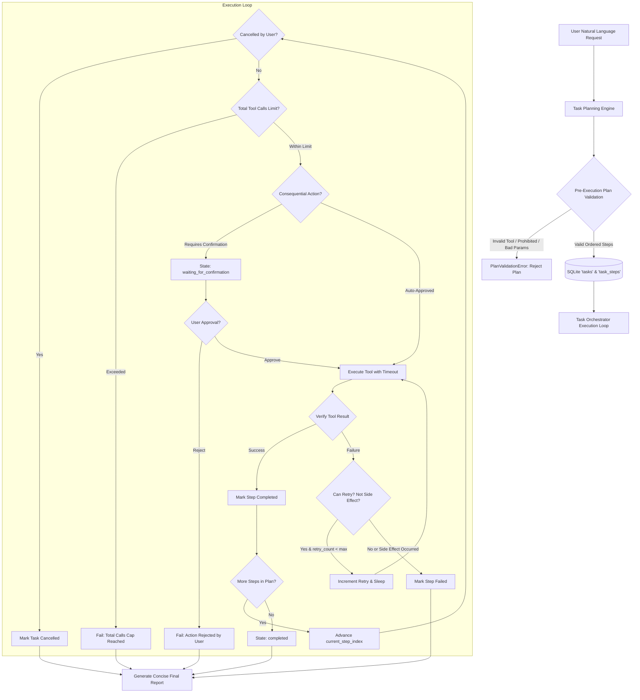

# AURA Multi-Step Task Orchestration & Autonomous Workflow Architecture

## 1. Executive Summary & Design Principles

**Phase 8: Task Orchestration** equips AURA with the ability to translate natural language user goals into structured, ordered, multi-step task plans and execute them autonomously with human-in-the-loop review, timeout controls, cancellation, retry limits, duplicate side effect prevention, and verifiable outcome auditing.

Like all AURA subsystems, task orchestration operates strictly under local-first and zero-implicit-trust principles:

1. **Structured, Typed Step Representation**: Tasks are decomposed into an ordered array of discrete steps. Each step references a specific registered tool and validated arguments matching strict Pydantic schemas.
2. **Pre-Execution Plan Validation**: Before executing any side effects, the plan is validated against the tool registry. Any unknown tool names, prohibited operations (Tier 4), or malformed parameters cause the plan to be rejected immediately with `PlanValidationError`.
3. **No Direct Shell or Code Execution**: The language model never receives arbitrary command-line execution or shell access (`cmd.exe`, `powershell.exe`). All actions run exclusively through strongly-typed tools in [`ToolRegistry`](file:///c:/Projects/AURA/services/agent/aura_agent/tools/registry.py).
4. **Mandatory Human-in-the-Loop Review**: Consequential write operations (Tier 2/3) halt execution and transition the task into `waiting_for_confirmation`. Execution only proceeds after explicit user approval.
5. **Execution Bounds & Circuit Breakers**: Configurable step timeouts (`task_step_timeout_seconds`), retry limits (`task_max_retries_per_step`), and total tool call ceilings (`task_max_total_tool_calls`) prevent runaway execution loops.
6. **Duplicate Side Effect Prevention**: If a step fails or is interrupted after a write operation or external side effect has already occurred (`side_effect_occurred = True`), automatic retries are blocked to prevent duplicate modifications.
7. **Complete User Observability & Cancellation**: Live step progress, tool invocations, duration, and failures are streamed to the desktop UI, and running or waiting tasks can be cancelled at any time by the user.



---

## 2. Task & Step Lifecycle State Machine

AURA models tasks and individual steps as finite state machines.

### Task States:
* `planned`: Plan created, validated, and persisted in SQLite. Ready for execution.
* `running`: Actively executing steps in sequential order.
* `waiting_for_confirmation`: Paused at a consequential step awaiting user approval in the desktop UI.
* `completed`: All steps successfully executed, verified, and finalized.
* `failed`: A non-recoverable error occurred, a required permission was denied, or limits were exceeded. Execution halted safely.
* `cancelled`: Terminated by user request. All subsequent steps marked cancelled.

### Step States:
* `pending`: Awaiting its turn in the sequence.
* `running`: Tool is currently being executed.
* `waiting_for_confirmation`: Awaiting user review decision.
* `completed`: Tool finished with verified success.
* `failed`: Tool failed or retries exhausted.
* `skipped`: Bypassed because a previous prerequisite step failed.
* `cancelled`: Bypassed due to task cancellation.

---

## 3. Database Schema

Managed by SQLAlchemy models in [`services/agent/aura_agent/models/db.py`](file:///c:/Projects/AURA/services/agent/aura_agent/models/db.py#L80-L135):

### Table: `tasks`

| Column | Type | Description |
| :--- | :--- | :--- |
| `id` | `VARCHAR(36)` | Primary Key UUID. |
| `session_id` | `VARCHAR(36)` | Associated conversation session (optional). |
| `title` | `VARCHAR(255)` | Human-readable title of the task. |
| `description` | `TEXT` | Summary of the task objective. |
| `state` | `VARCHAR(30)` | Task state (`planned`, `running`, `waiting_for_confirmation`, `completed`, `failed`, `cancelled`). |
| `current_step_index` | `INTEGER` | 0-indexed pointer to the active step. |
| `total_steps` | `INTEGER` | Total number of planned steps. |
| `max_retries_per_step` | `INTEGER` | Maximum automatic retries per step (default 2). |
| `max_total_tool_calls` | `INTEGER` | Circuit breaker capping total tool calls (default 10). |
| `total_tool_calls` | `INTEGER` | Total tool calls executed so far across all steps and retries. |
| `error_message` | `TEXT` | Primary cause of failure if state is `failed` or `cancelled`. |
| `final_report` | `TEXT` | Generated concise Markdown summary of outcomes. |
| `plan_json` | `TEXT` | Serialized JSON representation of the original plan. |
| `metadata_json` | `TEXT` | Safe execution metadata and timing details. |
| `created_at` | `DATETIME` | UTC creation timestamp. |
| `updated_at` | `DATETIME` | UTC update timestamp. |
| `completed_at` | `DATETIME` | UTC completion timestamp. |

### Table: `task_steps`

| Column | Type | Description |
| :--- | :--- | :--- |
| `id` | `VARCHAR(36)` | Primary Key UUID. |
| `task_id` | `VARCHAR(36)` | Foreign key referencing `tasks.id`. |
| `step_index` | `INTEGER` | Sequential step order index (0, 1, 2...). |
| `title` | `VARCHAR(255)` | Description of what this specific step does. |
| `tool_name` | `VARCHAR(100)` | Name of registered tool to invoke. |
| `parameters_json` | `TEXT` | Serialized JSON arguments for the tool. |
| `state` | `VARCHAR(30)` | Step state (`pending`, `running`, `completed`, `failed`, `cancelled`). |
| `retry_count` | `INTEGER` | Number of retries attempted for this step. |
| `max_retries` | `INTEGER` | Maximum retries allowed for this step. |
| `side_effect_occurred` | `BOOLEAN` | True if a write or external mutation occurred. |
| `result_summary` | `TEXT` | Verifiable outcome summary string. |
| `result_data_json` | `TEXT` | Structured output payload from the tool. |
| `error_message` | `TEXT` | Error text if tool failed. |
| `duration_ms` | `FLOAT` | Elapsed execution time in milliseconds. |

---

## 4. Safety Guardrails & Failure Prevention

### 4.1 Pre-Execution Plan Validation
Before running any code, [`TaskOrchestrator.validate_plan`](file:///c:/Projects/AURA/services/agent/aura_agent/services/orchestrator.py#L65-L105) inspects the submitted plan:
* Step count must be $> 0$ and $\le$ `task_max_steps` (default 15).
* Step titles cannot be empty.
* Tool name must exist in `tool_registry.get(tool_name)`.
* Prohibited (Tier 4) tools are rejected immediately.
* Tool parameters are validated against Pydantic schema: `tool.args_schema(**parameters)`.

### 4.2 Duplicate Side Effect Prevention
One of the most dangerous failure modes of autonomous agents is blindly retrying operations that have external side effects (e.g. creating duplicate notes, appending twice to files, or repeating external actions):
* When a tool classified under Tier 2 (Monitored Write) or Tier 3 (System External) begins executing or mutates state, `side_effect_occurred` is set to `True`.
* If a step subsequently fails or encounters an error while `side_effect_occurred == True`, automatic retries are strictly blocked:
  ```text
  Duplicate side effect prevention: Step was already partially executed or performed
  a write operation and cannot be retried automatically without risking duplicate modifications.
  ```

### 4.3 Timeouts & Resource Bounds
* **Step Timeout**: Wrapped in `asyncio.wait_for(..., timeout=task_step_timeout_seconds)` (default 30.0s). If an external tool hangs, it is aborted with a `TIMEOUT` audit entry.
* **Total Tool Calls Cap**: Guarded by `task.total_tool_calls >= task.max_total_tool_calls` (default 10). Prevents runaway reasoning loops.

### 4.4 Cancellation Token
Tasks can be cancelled asynchronously via the desktop UI or REST API:
* Setting the cancellation token causes the execution loop to immediately halt before the next step or retry.
* The active step is marked `cancelled`, remaining steps are marked `cancelled`, and a final cancellation report is logged.

---

## 5. Desktop UI Observability

The desktop application includes a dedicated **Task Orchestration Activity Panel** integrated directly into the application shell:

1. **Live Step Checklist**: Shows current progress (e.g., "Step 2 of 4: List project files"), live status badges, tool names, and execution durations.
2. **Interactive Confirmation Gate**: When a task pauses on a consequential action (e.g., creating a note or opening an app), an inline review banner displays the parameters and reason with **Approve** and **Reject** buttons.
3. **Cancel Task**: An accessible "Cancel Task" button allows the user to terminate any active or waiting workflow with a single click.
4. **Plan Multi-Step Task Modal**: Accessible via the `+ New` button in the header. The user can enter a goal in natural language; AURA prompts the local Ollama model to generate a structured, validated plan and review the steps before execution.
5. **Execution Reports**: Click "View Execution Report" on any finished task to inspect the formatted Markdown report detailing timestamps, step outcomes, and failure diagnoses.

---

## 6. REST API Reference

Mounted at `/api/tasks` in [`aura_agent.api.tasks`](file:///c:/Projects/AURA/services/agent/aura_agent/api/tasks.py):

| Endpoint | Method | Request Payload | Description |
| :--- | :--- | :--- | :--- |
| `/api/tasks/plan` | `POST` | `CreateTaskPlanRequest` | Convert a natural language prompt into a validated multi-step plan using Ollama. |
| `/api/tasks` | `POST` | `CreateTaskRequest` | Validate and persist an ordered task plan (HTTP 201 Created). |
| `/api/tasks` | `GET` | `?session_id=&state=&limit=` | List tasks with live execution metadata. |
| `/api/tasks/{id}` | `GET` | None | Retrieve full task details, step progression, and active review proposals. |
| `/api/tasks/{id}/execute` | `POST` | None | Start or resume execution of the task. |
| `/api/tasks/{id}/confirm` | `POST` | `TaskConfirmationRequest` | Submit user decision (`approved: true/false`, `guidance`) for a waiting step. |
| `/api/tasks/{id}/cancel` | `POST` | `TaskCancelRequest` | Cancel a running or waiting task. |

---

## 7. Verification & Automated Test Suite

Verified across both backend pytest integration and desktop Vitest component suites:

* **Backend Test Suite** (`services/agent/tests/test_tasks.py`):
  * `test_plan_validation_and_rejection`: Asserts invalid tools, bad schemas, and empty plans are rejected before execution.
  * `test_successful_multi_step_task`: Validates ordered multi-step execution, state transitions, step metrics, and report formatting.
  * `test_failed_task_and_stop_workflow`: Confirms that step failure halts subsequent steps.
  * `test_consequential_action_confirmation_and_rejection`: Asserts execution pauses at review gate and terminates on rejection.
  * `test_consequential_action_confirmation_and_approval`: Asserts approval resumes execution and completes the workflow.
  * `test_task_cancellation`: Asserts immediate cancellation of planned and running workflows.
  * `test_duplicate_side_effect_prevention`: Proves steps with mutations are never retried blindly.
  * `test_total_tool_calls_cap_enforcement`: Tests the circuit breaker preventing runaway loops.
  * `test_task_timeout_handling`: Verifies timeout handling when a tool hangs.
  * `test_task_api_endpoints`: End-to-end HTTP tests covering plan, create, get, list, execute, confirm, and cancel.
  * **Result**: **10 / 10 tests passed (85 / 85 across the entire backend)**.

* **Frontend Test Suite** (`apps/desktop/test/TaskOrchestration.test.tsx`):
  * Tests header, task count, and active steps rendering.
  * Tests confirmation review banner with Approve/Reject actions.
  * Tests cancellation button interaction.
  * Tests task planning modal and natural language plan generation.
